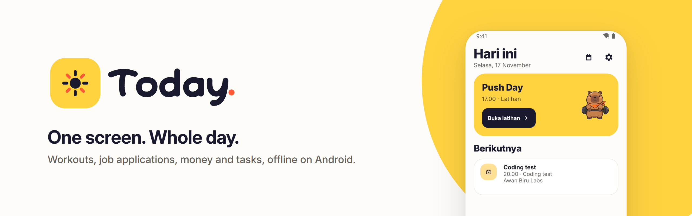
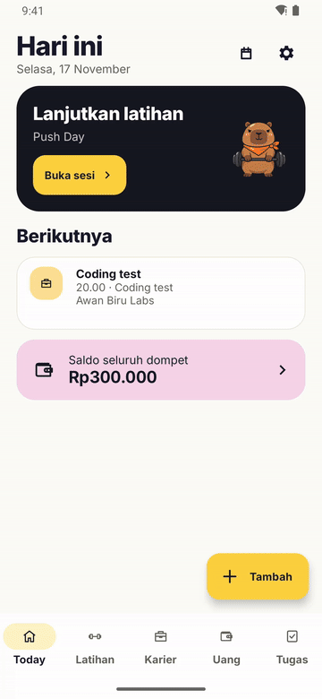
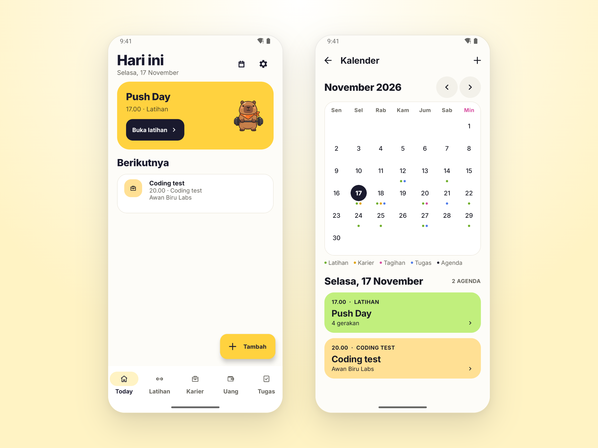
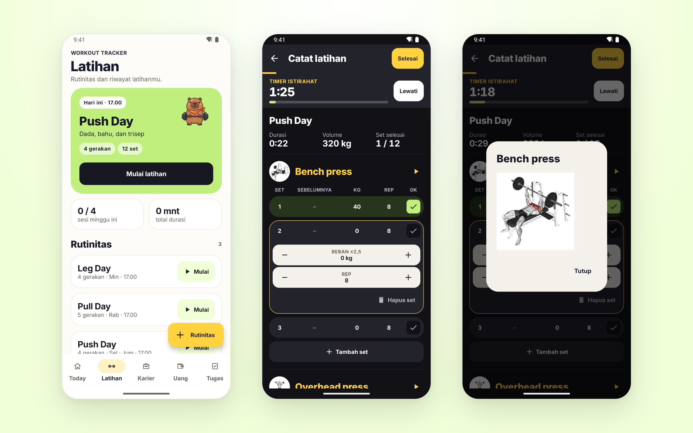
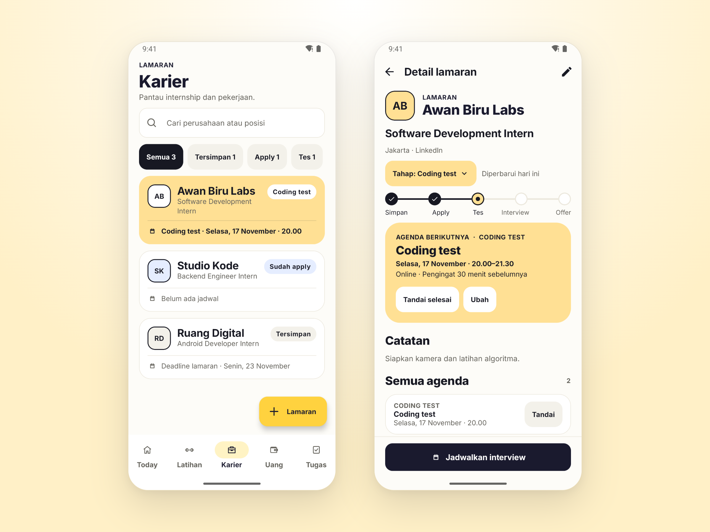
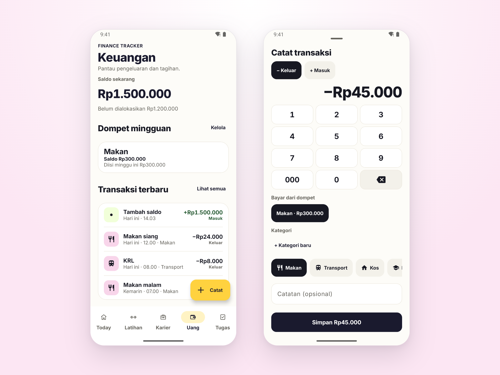
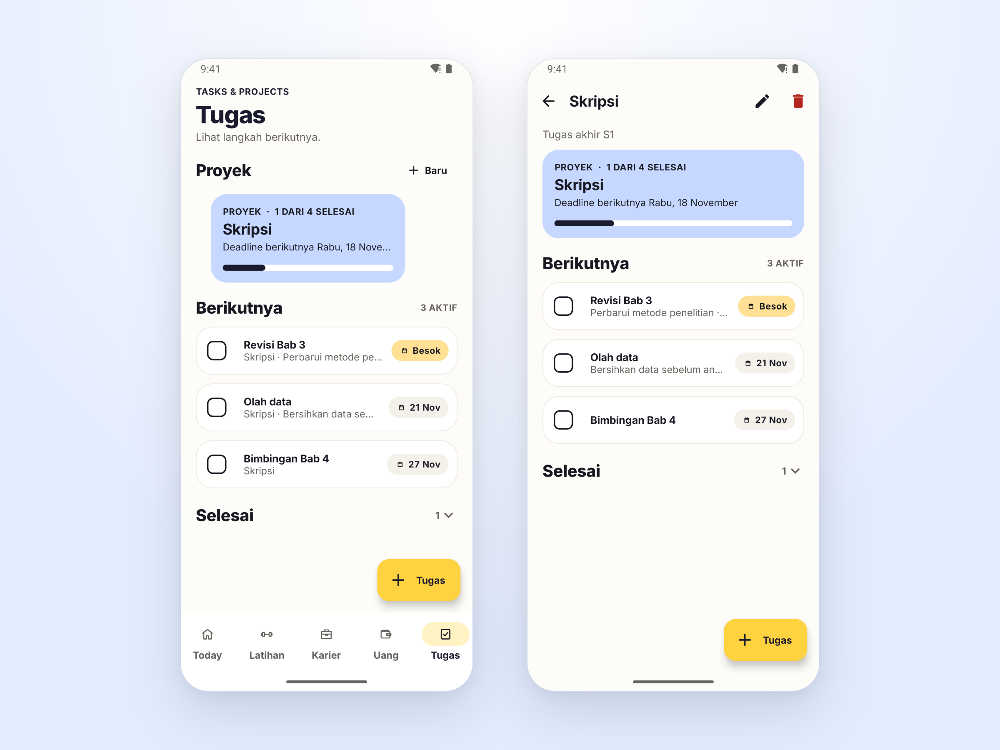
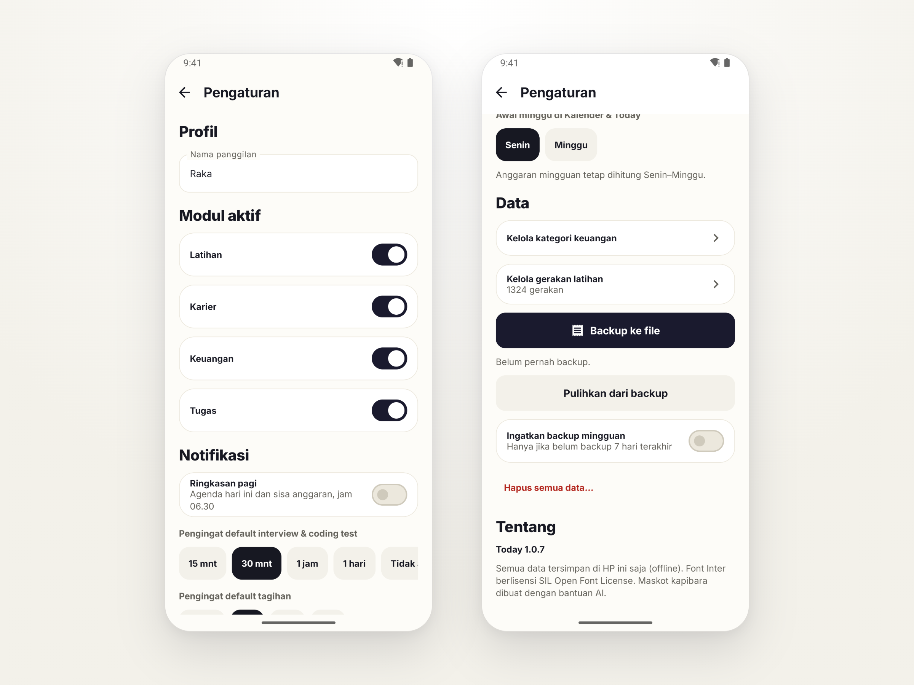
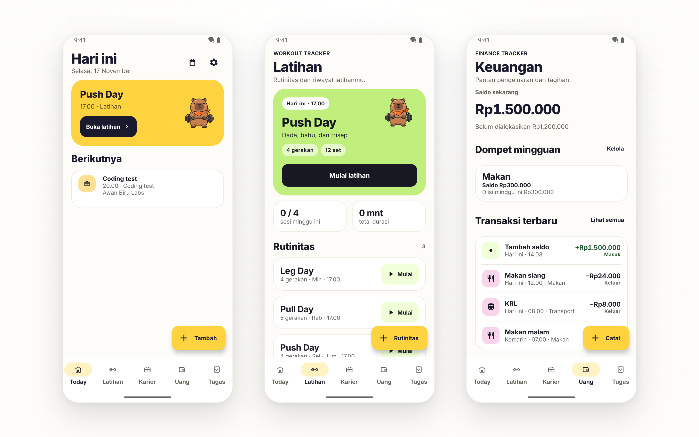

<div align="center">



# Today

### One screen. Whole day.

An offline Android app that puts one person's workouts, job applications, money and tasks on a single *Today* screen.


[See the demo](#-demo) · [Key features](#-key-features) · [Run it locally](#-running-locally) · [Setup guide](docs/SETUP.md)

</div>

> [!TIP]
> **Pick *Data contoh* on the last onboarding step** to start with a full set of sample routines, job applications, budgets and tasks. You can edit or delete all of it later.

> [!NOTE]
> **The app UI is in Indonesian** and amounts are in rupiah. It is a personal project for one user: there is **no account, no server and no sync**.

---

## 🧩 Problem

A student who trains, hunts for internships and lives on a weekly budget ends up with one app per part of the day.

- **Scattered**: the gym log, the job tracker, the expense app and the to-do list each hold a piece of the same day;
- **Missed dates**: a coding test, a bill or a thesis deadline sits in the one app you did not open;
- **Accounts**: most of these apps want a sign-up and send personal data to a server.

## 💡 Solution

Today keeps the four parts in one app and shows **what matters right now on one screen**. Every module writes into a shared agenda, so the *Today* screen and the calendar always show workouts, interviews, bills and task deadlines together. Everything is stored **only on the phone**, and a JSON backup file is the way to move it.

<div align="center">

| 📝 **Record** | 📅 **See it together** | 🔔 **Get reminded** |
|:---:|:---:|:---:|
| Log a set, a job application, an expense or a task in its own module. | The *Today* screen and the calendar merge every dated item into one agenda. | Alarms fire for interviews, bills, workouts and rest timers, even after a reboot. |

</div>

## 🎬 Demo

<div align="center">


<sub>Logging an expense from the <i>Today</i> screen in about 9 seconds: amount, wallet, note, save.</sub>
</div>

## ✨ Key features

### ☀️ Today screen and calendar

The *Today* screen shows the next thing to do as a large focus card (for example *Push Day* at 17.00), followed by the rest of today's agenda and the total balance of your wallets. One *Tambah* button adds a task, event, transaction or job application from anywhere. The calendar shows a month grid with colored dots per module and the full agenda for the selected day.



### 🏋️ Workout tracker

- **Routines**: plan *Push*, *Pull* and *Leg* days with a weekly schedule and see sessions and minutes for the week.
- **Session log**: tap a set to change the weight in **2.5 kg steps** and the reps, then tick it off. Volume and duration update live.
- **Rest timer**: ticking a set starts a **90-second** rest countdown with *Lewati* (skip) and a notification that can add 30 seconds.
- **Exercise catalog**: **1,324 exercises** with an animated demo for each, bundled in the app so it works offline.
- **Personal records** are detected when you lift more than your previous best for an exercise.



### 💼 Job application tracker

Each application moves through clear stages, and the next coding test or interview is shown on the card and on the *Today* screen. Interview reminders default to **30 minutes before** and can be changed per event.

| Stage | Meaning |
|---|---|
| ⚪ *Tersimpan* | Saved, not applied yet (can have an application deadline) |
| 🔵 *Sudah apply* | Application sent |
| 🟡 *Coding test* | Coding test scheduled |
| 🟠 *Interview* | Interview scheduled |
| 🟢 *Offer* | Offer received |
| 🔴 *Ditolak* / *Dibatalkan* | Rejected or withdrawn |



### 💸 Money and bills

- **Weekly wallets**: split your balance into wallets such as *Makan* and pay each expense from one of them.
- **Quick entry**: a number keypad, a category chip and an optional note. Saving takes three taps.
- **Budgets and bills**: weekly or monthly budgets per category, and recurring bills with a reminder **1 day before** by default. Paying a bill records the expense and moves the due date forward.
- **Monthly summary**: income, expenses and the share of each category.



### ✅ Tasks and projects

Group tasks into projects with a progress bar, set a due date and priority, and see the next three open tasks at the top. Tasks with a due date show up on the *Today* screen and in the calendar.

<details>
<summary><b>See a screenshot of tasks and projects</b></summary>
<br>

</details>

### 🔔 Reminders, backup and privacy

Reminders use exact alarms and are **rescheduled after a reboot**. An optional morning summary at **06.30** lists the day's agenda and the remaining budget. All data stays in a local database: **nothing is sent to a server**. *Backup ke file* saves everything to one JSON file through the Android file picker, and *Pulihkan dari backup* replaces all data in a single transaction, so a failed restore changes nothing.

<details>
<summary><b>See a screenshot of the settings</b></summary>
<br>

</details>

### 📱 Built for one hand

Today is a phone app first: a bottom bar with the five modules, large touch targets, a yellow action button within thumb reach, and bottom sheets for quick entry. Modules you do not use can be hidden in settings. Icon buttons have **TalkBack labels**, and long text wraps instead of being cut off at large font sizes.



## 🧰 Tech stack

| Layer | Technology |
|---|---|
| Language | **Kotlin 2.0** (KSP, coroutines and Flow) |
| UI | **Jetpack Compose** with **Material 3** (Compose BOM 2024.09, Navigation Compose 2.8, Inter font) |
| Data | **Room 2.6** on SQLite (exported schema, tested migrations), **DataStore** for preferences |
| Background | **AlarmManager** for exact reminders, **WorkManager 2.9** for the daily summary and backup reminder |
| Backup | **JSON file** through the Storage Access Framework |
| Tests | **JUnit 4**, **Robolectric 4.13**, Turbine, room-testing (79 JVM tests) |
| Build | **Gradle 8.10**, Android Gradle Plugin 8.7, min SDK 26 (Android 8.0), target SDK 35 |

## 🚀 Running locally

```bash
git clone https://github.com/hanchyp/today-app.git
cd today-app
echo "sdk.dir=/path/to/Android/Sdk" > local.properties   # point Gradle at your Android SDK (API 35)
./gradlew testDebugUnitTest                               # run the JVM tests
./gradlew assembleDebug                                   # build app/build/outputs/apk/debug/app-debug.apk
```

You need JDK 17 and the Android SDK with API 35. No environment variables or API keys are needed. Install the APK on a device or emulator; see the [setup guide](docs/SETUP.md) for release signing and installing on MIUI phones.

## 📁 Project structure

```
app/src/main/java/com/farhan/today/
├── data/            # Room database, repositories, DataStore prefs, JSON backup
├── domain/          # models, formatters (rupiah, dates), workout math, Today use case
├── reminder/        # alarm scheduling, boot receiver, daily workers
├── workout/         # rest timer
└── ui/              # Compose screens per module, theme and shared components
app/src/main/assets/ # exercise catalog JSON and animated WebP demos
app/src/test/        # JVM tests (repositories, DAO, migrations, reminders)
app/schemas/         # exported Room schemas for migration tests
docs/                # setup guide, sprint plan, UX audit, logo
scripts/readme-assets/ # scripts that capture the README images
```

## 🛣️ Roadmap

- [ ] Run the device checklist from the UX audit on a real phone (font scale, TalkBack, keyboard in forms)
- [ ] Show the rest timer end time on a Huawei Band through the phone notification
- [ ] English UI strings next to Indonesian
- [ ] Optional sync server, using the sync-ready schema (UUID ids, soft delete) already in place

---

<div align="center">

Built with ❤️ by [@hanchyp](https://github.com/hanchyp)

</div>
